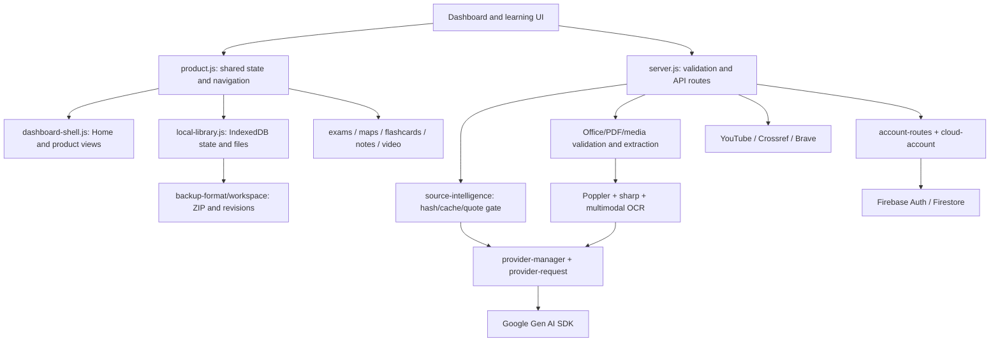

# Milestone 00 — Repository Audit & Safety Baseline

**Status: COMPLETE (audit scope).** This does not mark the transformation or v1.0.0 release complete. Reviewed on 7 November 2026 (Asia/Jakarta). The supplied executable roadmap requires one milestone per delivery; Milestones 01–12 have not been started by this audit.

## 1. Scope, recovery and provenance

- Repository: `JTDevArt/omnilearn-gemini-cloud.`; the trailing period is part of the name.
- Original local checkout: `1cdc4adbb38b2e866179d6d850c5beb3d4818a40` on `work`.
- Latest upstream main fetched at audit start: `2cf6e5bd25e4018a52b30d82b3a142715277a97f`. Its only addition over the local commit was `docs/ASTRA_OMNILEARN_MASTER_PROMPT_v1.0.0.md`; it was incorporated by fast-forward without overwriting the pending dashboard files.
- Upstream recovery reference: `recovery/milestone-00-upstream-20261107` at `2cf6e5bd25e4018a52b30d82b3a142715277a97f`.
- Previously delivered dashboard work was still uncommitted. It is preserved in development commit `f9fa9a889cf4293c5c6fe1d232f9c07cb5b2d1c4` and recovery reference `recovery/milestone-00-dashboard-20261107`, before the audit fix.
- Delivery branch: `main`. Recovery refs are local; the original and baseline commit objects remain ancestors of the main delivery. Do not reset or force-push to recover. Revert a reviewed change or create a new branch from the recorded SHA.
- No user data, original uploads, lockfiles, security controls, database versions, or cloud settings were removed or migrated. No production deployment or release tag was created.

Prior reports reviewed: `MAX-UPGRADE-STATUS.md`, `PRODUCT-V2-DELIVERY.md`, `FINAL-FORGE-STATUS.md`, `FORGE-V2.1-STATUS.md`, `MASTER-PROFICIENCY-STATUS.md`, plus `README.md`, `DEPLOYMENT.md` and the new upstream master directive. Old reports describe historical checks and superseded gaps. Their live-AI/browser/container claims are not represented as fresh evidence.

## 2. Feature inventory

`WORKING` means the described local/fixture scope passed; it does not imply external services or all acceptance criteria passed.

| Area | Classification | Evidence and remaining scope |
| --- | --- | --- |
| Express server, landing and dashboard | WORKING | Local health identifies `forge-2.1`; dashboard and legacy routes open. No bundler output is required. |
| Home composer/conversation | WORKING / BLOCKED | Real browser uses shared conversation DOM and selected-source analysis path. Explicit unavailable-provider fixture is rendered and recoverable. Live Gemini is blocked by missing key. |
| New sidebar and contextual tools | PARTIAL | Main destinations, old URLs, collapse/drawer and classic/new entry work. New roadmap order, `home` naming, full contextual extras and keyboard behavior remain. |
| Local library and original files | WORKING | IndexedDB transactions, namespace isolation, revisions and file API inspected. Prior original-file browser evidence is historical; current suites exercise source identity/backup, and current browser checks exercise subjects/pins/profile reload. |
| Source revisions and blueprint | WORKING / BLOCKED | Hash/version/language/session cache, exact quotes and graph integrity pass fixtures. Semantic accuracy and live model access are unverified. |
| Upload, native PDF, image transforms | WORKING | Native/scanned/mixed PDF transport fixtures, image transforms, Office expansion and media validation pass. OCR outputs are fixtures; actual OCR accuracy is not established. |
| Tutor, summaries, flashcards, quizzes | WORKING / BLOCKED | Policy, context, structured output, scheduling and grading fixtures pass. No fresh live tutoring/learning-quality benchmark. |
| Mindmaps and exams | WORKING / PARTIAL | Graph, timer, grading, multipart and persistence-related fixtures pass; exam view opens. Full new roadmap presets/workspace acceptance remain. |
| ZIP backups and version restore | WORKING | Roundtrip, corruption, traversal/prototype, duplicates and restore tests pass. Current new-dashboard browser check does not repeat the historical full ZIP UI journey. |
| Subjects and pins | WORKING / PARTIAL | Creation/pinning/reload tested. Legacy preference data-loss regression fixed here. Subject sorting and more granular note/chapter/card pins remain. |
| Streak/XP/calendar | WORKING / PARTIAL | Real event calculations tested; calendar renders. History is bounded to 1,000 events; no completed focus-timer or weekly-progress system. |
| Leaderboard | PARTIAL | Honest unavailable page; no cross-user ranking service or fabricated users. |
| Profile/preferences | PARTIAL | Name/language and subject fields persist across the legacy form after the fix. Avatar upload and complete privacy/storage UI remain. |
| Native video | PARTIAL | Existing player/subtitles/seek/sample renderer reused; progress saves on pause/end. Fresh actual-video playback was not rerun in this audit. YouTube progress and abrupt-close durability remain. |
| YouTube captions | BLOCKED | Official authorized adapter and manual transcript path exist; OAuth token absent. No consent/refresh lifecycle. |
| Podcast and research | BLOCKED / PARTIAL | Audio adapter and evidence registry/synthesis fixtures pass. No live TTS/research; Crossref is network-restricted and Brave key absent. Metadata retrieval is not full-article verification. |
| Firebase accounts/sync | BLOCKED | Account ownership, cookies/CAS and conflict fixtures pass. Config absent; Firestore rules and real email/two-device acceptance unverified. |
| Update history | DESIGN DEBT | Existing `v1.01` development history predates SemVer roadmap. Search/filter/validated release manifest and commit links belong to Milestone 11. |
| Security | WORKING / PARTIAL | CSP nonce, Origin/Fetch Metadata, upload/request bounds, escaped rendering and ownership fixtures pass. Guest quota spending, shared replica limits and production penetration testing remain. |
| Deployment | BLOCKED | No deployment performed. Hosted health probe was policy-denied; source push cannot establish deployed version. |

## 3. Dependency and reuse map

Reuse: current Gemini client and queue, source analysis, upload formats, local library transactions, exam/mindmap/review engines, media renderer, account routes and backup validator. Modify incrementally: `product.js`, `dashboard-shell.js`, profile save boundaries, route mapping, CSS and release manifest. Retire only verified duplicate visible controls/styles after replacements pass; no backend subsystem is scheduled for deletion.

Frontend entry points: `/` uses `public/landing.html`; `/dashboard` uses `public/index.html`, inline learning controller, `product.js`, `dashboard-shell.js` and shared domain modules. Theme tokens and rules are layered across `styles.css`, `product.css`, `workbench.css`, `jarvis.css`, `forge.css`. `product.css` includes repeated selectors and appended overrides; the new shell adds another block at its start. HTML contains older navigation/workspace markup while JS adds main/header/material navigation; legacy `.tabs` remains visible in the learning workspace. Consolidation needs visual/keyboard regression checks, not wholesale removal.

Backend boundary: `server.js` owns transport, CSP/security middleware, size limits, routes and SDK initialization. `lib/` contains learning policy, source validation, request scheduling, file preprocessing and integration adapters. External binaries: `pdftoppm` for targeted scan rendering; `sharp` is a native npm dependency. No Docker build is necessary for the Node development workflow.

## 4. Data contracts

| Store/format | Contract to preserve |
| --- | --- |
| IndexedDB | DB version 1; guest DB `omnilearn-library`, account DB `omnilearn-library:<verifiedUid>`; object stores `state` and `files`. |
| Library state | `state['library'] = {revision, value}`. Value uses `schemaVersion: 1`, `clearedAt`, sources, profile, activity, sticky notes, free chat/note and pending tasks. |
| Concurrency | Serialized transactions compare the saved revision before writing; conflicting tabs reject rather than silently overwrite. |
| Original uploads | File keys `<sourceId>:<version>`; separate from extracted text. `hasOriginal` indicates availability, not a promise for historical uploads. |
| Source revisions | Stable source ID, positive version, text/metadata, notes/chat/generated outputs/deck/reviews/exams/journey, optional older `versions`; changes invalidate derived artifacts. |
| Source analysis | `forge-1`; SHA-256 text hash; cache key includes session, source ID, version, language, partial state and blueprint version. Quote offsets/page markers derive from actual input. |
| Session storage | Active source/chat, local library fallback, tool options, selected account owner and deletion epoch. It is not the sole durable store. |
| Deletion | Deliberate clear writes a tombstone/epoch and increments revision; do not remove this stale-tab protection. |
| Backup | `omnilearn-backup/1`; SHA-256, bounded ZIP entries, original-file mapping; `before-import` rollback snapshot. Source IDs/versions/graph/exam structures are validated. |
| Cloud | Verified UID resource paths, owner field, revision/CAS preconditions and verified-email writes. Original binary files remain local. |

Limits: uploads 15 MiB, accepted source text 50,000 characters, library JSON 8 MiB/200 sources, ZIP expanded data 100 MiB, original file 15 MiB; source revision chain bounded to 100 entries. Not every optional newly added profile/source field has a schema constraint; see R02.

## 5. API inventory

| Routes | Responsibility |
| --- | --- |
| `GET /api/health`, `/api/capabilities`, `/api/provider/status`, `/api/integrations` | Safe version/configuration/cooldown/capability metadata; health `ready` means key presence only. |
| `POST /api/upload`; `GET /api/upload/status/:jobId` | Multipart/base64 input, queued extraction/OCR, bounded in-memory job polling. |
| `POST /api/source/analyze` | Scoped canonical blueprint and source validation/cache. |
| `POST /api/chat`, `/api/study`, `/api/speech` | Tutor, learning artifacts and generated audio. |
| `POST /api/quiz/check`, `/api/exam/grade` | Objective quiz checks and validated AI-assisted assessment. |
| `POST /api/session/clear` | Clear scoped server caches/jobs. |
| `POST /api/youtube/transcript` | Authorized captions; manual transcript flow remains local. |
| `POST /api/research/search`, `/api/research/synthesize` | External metadata registry and evidence-linked synthesis. |
| `/api/account/*`, `GET/POST /api/cloud/library` | Register/login/logout/refresh, verification/reset/profile, identity and owner-scoped synchronization. |
| `/vendor/*`, static public assets | Local scripts/fonts/styles under security middleware; private source files excluded. |

## 6. Confirmed bugs and risk register

| ID / priority | Classification | Evidence, impact and next owner |
| --- | --- | --- |
| R01 / P0 | CONFIRMED BUG — fixed | Reproduce: create empty subject `Biologi`, set profile language `en`, save the legacy preferences form, reload. Both fields disappeared. `settingsView()` replaced the entire profile. Minimal `...profile` merge preserves unrelated fields; new browser assertions pass. Essential safety fix before publishing prior dashboard work. |
| R02 / P1 | CONFIRMED BUG — open | `validateLibrary({schemaVersion:1,sources:[],profile:{subjects:42}})` succeeds. Opening Subjects with that accepted profile throws `(profile.subjects || []) is not iterable`. Validate new profile/metadata types and handle invalid historical state without deleting data. Milestone 01. |
| R03 / P1 | CONFIRMED BUG — open | At 360 px with drawer closed, toggle reports `aria-expanded=true`; off-screen sidebar link accepts focus at x=-222. Synchronize expanded state, focusability and chosen modal/non-modal behavior. Milestone 05. |
| R04 / P1 | DESIGN DEBT | `persist()` starts asynchronous IndexedDB save; several new view save messages describe success before transaction completion. Quota/conflict errors are toasted later. Await/propagate durability for user-visible acknowledgements. Milestone 01. |
| R05 / P0 production gate | PARTIAL | Guest AI endpoints can spend quota; process-local rate/circuit state is not shared across replicas. Choose authenticated spending and ingress controls before public scaling. Security/release gate. |
| R06 / P1 | DESIGN DEBT | Global `unhandledRejection` handler logs only error name and continues for all failures. Scope expected PDF compatibility handling and test unexpected failures. Milestones 02/03. |
| R07 / P1 | PARTIAL | Upload jobs, cooldowns and analysis cache are process-local; jobs expire after 15 minutes. Restart recovery/durable background work is not implemented. Milestones 01–03. |
| R08 / P1 | DESIGN DEBT | Navigation globally blocks while AI/upload is busy; repeated CSS layers and main/legacy tab controls increase coupling. Preserve safe cancellation/source ownership while improving navigation. Milestones 04/05. |
| R09 / P1 | PARTIAL | Home lacks roadmap focus timer, dedicated recent/resume cards and complete input/intent flow. Profile lacks avatar upload; subjects lack sort; release manifest lacks SemVer validation/search. Milestones 06/08/09/11. |
| R10 / P0 release gate | BLOCKED | Gemini/Firebase/YouTube/Brave bindings unset. Model availability, live OCR quality, auth/email/rules and real external acceptance cannot be claimed. Crossref/design/hosted access constrained by network policy. |
| R11 / P1 | DESIGN DEBT | UI `v1.01`, package `1.0.0`, backend `forge-2.1` have different purposes. Preserve historical UI history and backend identity; do not claim the planned v1.0.0 shipped. Milestone 11. |
| R12 / P1 | PARTIAL | Native-video position saves on pause/end; abrupt browser shutdown can lose the latest position. Current activity retention is 1,000 events, so lifetime/annual summaries may be incomplete. Milestones 09/10. |

R02 and R03 were reproduced in isolated browser profiles; no user library was altered. They remain explicitly open rather than being concealed by passing smoke checks. The audit does not claim exhaustive bug discovery or a penetration test.

## 7. Regression and research baseline

Current commands/results:

- `npm ci --no-audit --no-fund --cache /workspace/.npm`: passed using the unchanged lockfile; 157 packages installed. `node-domexception` deprecation warning remains; no trust checks disabled.
- `npm test`: **104 passed, 0 failed, 0 skipped** before the audit fix; repeated after the fix with the same result.
- `npm run build`: passed; 48 JS modules, HTML inline scripts and migration invariants.
- `npm run lint`: passed (the existing script is a syntax check).
- `npm audit --json`: **0 advisories**; not a container/OS CVE assessment.
- `node scripts/verify-dashboard-browser.mjs` using external Playwright, local Chromium and local server: passed subjects/pins/profile reload, escaped source titles, **12 combinations** (1440/1280/1024/768/390/360 × light/dark), drawer/Escape, unavailable-provider conversation and main/legacy routes. Providers are explicit fixtures; storage/navigation are real browser operations.
- Local `/api/health`: `productVersion: forge-2.1`, `ready: false` with no Gemini key. This is honest local startup evidence, not live AI readiness.
- `git diff --check`: passed. No manifest/lockfile changes.

The 104 Node tests cover learning/output-language/context policy, cards/quizzes/activity, Office/media validation, real local image transforms, native/scanned/mixed PDF SDK transport fixtures, provider cooldown/deadline/cancellation, source quotes/cache/isolation, cloud ownership/CAS/cookies, backup validation, exam/math grading, maps and speech. No zero-test run is counted as readiness. No fresh physical microphone, real-video playback, full browser backup journey, Firebase two-device, live inference, hosted app or container test was performed in this audit.

Detailed official-source research, access failures and recommendations: [00-research-notes.md](00-research-notes.md). Local test logs reside in `/tmp/milestone00-*`; browser screenshots in `/tmp/master-verified-*`. The committed browser script is repeatable; temporary evidence is not guaranteed to survive a new environment.

## 8. Completion checklist and next milestone

- [x] Existing functionality and module/API ownership documented.
- [x] Confirmed defects, design debt, external blockers and release risks distinguished.
- [x] Baseline tests and targeted browser reproduction executed.
- [x] Existing data formats and constraints documented.
- [x] Recovery references recorded before the audit fix.
- [x] No destructive changes or migrations.

Next executable work: **Milestone 01 — Data Integrity & Application Foundation**, using this baseline. Prioritize R02 typed import/profile validation, R04 truthful durable-save acknowledgements, original-file preservation, cross-tab/account isolation and unsaved-work recovery. Do not start Milestone 02 until the foundation acceptance checks pass. This milestone stops after GitHub delivery and the execution report. GitHub commit/push confirmation belongs to the delivery report; neither this document nor a source push establishes hosting publication.
